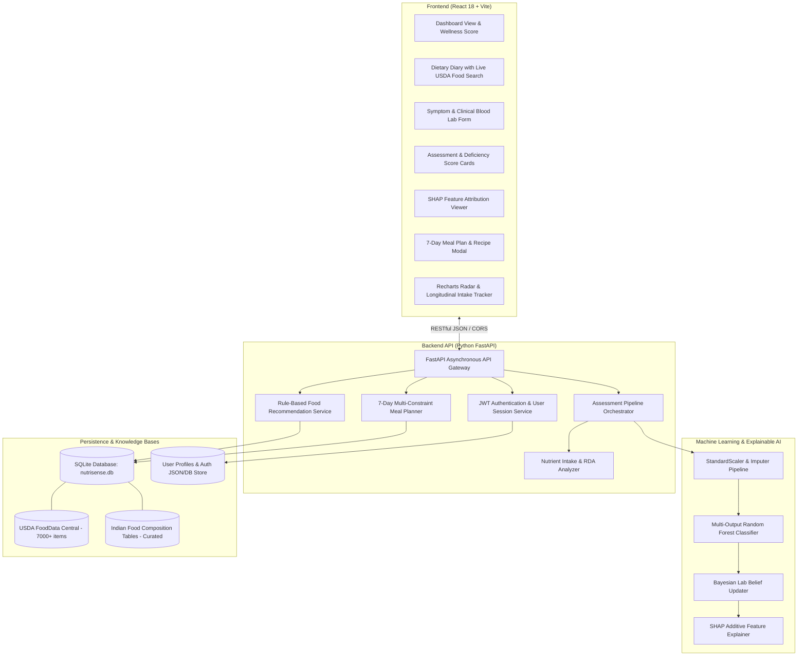

# AI-Based Nutritional Assessment System for Deficiency Detection & Personalized Meal Planning

[](https://springboard.infosys.com)
[](https://www.python.org/)
[](https://fastapi.tiangolo.com/)
[](https://react.dev/)
[](https://vitejs.dev/)
[](https://scikit-learn.org/)
[](https://shap.readthedocs.io/)
[-brightgreen?style=for-the-badge&logo=pytest&logoColor=white)](#testing--verification)
[](LICENSE)

> **Infosys Springboard Virtual Internship 7.0 (July 2026 Cohort)**  
> **Domain Track:** Artificial Intelligence & Healthcare Software Engineering  
> **Internship Duration:** 8 Weeks (July 06, 2026 – August 31, 2026)  
> **Project Author:** Smadhanraj S ([@Smadhanraj2005](https://github.com/Smadhanraj2005))

---

## 📌 Table of Contents
1. [Executive Summary & Problem Statement](#-executive-summary--problem-statement)
2. [Key System Highlights](#-key-system-highlights)
3. [End-to-End System Architecture](#-end-to-end-system-architecture)
4. [Machine Learning & Explainable AI Pipeline](#-machine-learning--explainable-ai-pipeline)
5. [Automated Recommendation & 7-Day Meal Planner](#-automated-recommendation--7-day-meal-planner)
6. [Technology Stack](#-technology-stack)
7. [Project Directory & File Structure](#-project-directory--file-structure)
8. [Step-by-Step Installation & Local Execution Guide](#-step-by-step-installation--local-execution-guide)
9. [REST API Documentation & Endpoints](#-rest-api-documentation--endpoints)
10. [Testing & Verification (Pytest Suite)](#-testing--verification)
11. [8-Week Internship Agile Lifecycle & Milestones](#-8-week-internship-agile-lifecycle--milestones)
12. [Challenges Overcome & Engineering Learnings](#-challenges-overcome--engineering-learnings)
13. [Internship Deliverables & Documentation](#-internship-deliverables--documentation)
14. [Acknowledgements & Disclaimer](#-acknowledgements--disclaimer)

---

## 🔬 Executive Summary & Problem Statement

Nutritional deficiencies affect over **2 billion individuals globally**, often remaining subclinical and unaddressed until they develop into chronic medical conditions such as iron-deficiency anemia, osteomalacia, rickets, neurological impairments, and metabolic dysregulation. 

Traditional healthcare pathways are fundamentally **reactive**: patients only receive dietary guidance after invasive, expensive, and delayed blood laboratory testing. 

### The Solution: NutriSense / NutriAI
This project delivers a **full-stack, non-invasive digital healthcare platform** that bridges the gap between self-reported daily diet logs, clinical symptom questionnaires, and laboratory biomarker reports. Powered by:
- **Ensemble Machine Learning** (`RandomForestClassifier`) trained on clinical nutritional datasets (NHANES).
- **Bayesian Belief Updating** to dynamically adjust prior dietary risks when clinical lab values (e.g., serum ferritin, 25-OH Vitamin D) are provided.
- **Explainable AI (SHAP)** to break down black-box predictions into transparent, human-readable risk drivers.
- **Multi-Constraint Heuristic Meal Planner** curating personalized 7-day culinary itineraries filtered by dietary lifestyles (Vegan, Gluten-Free, Dairy-Free, Keto, Vegetarian) and enriched with foods high in deficient micronutrients from **USDA FoodData Central** and **Indian Food Composition Tables (IFCT)**.

```
┌─────────────────┐    ┌─────────────────┐    ┌─────────────────┐    ┌─────────────────┐
│   User Diary    │    │ Clinical Labs   │    │ Physical        │    │ Demographics &  │
│ (Daily Intake)  │    │  (Blood Tests)  │    │ Symptoms (10+)  │    │ Dietary Flags   │
└────────┬────────┘    └────────┬────────┘    └────────┬────────┘    └────────┬────────┘
         │                      │                      │                      │
         └──────────────────────┼──────────────────────┴──────────────────────┘
                                ▼
         ┌────────────────────────────────────────────────────────────┐
         │     NutriSense Multi-Modal Assessment & ML Engine          │
         │  • 13-Feature Extraction (Averaged Daily Intake / RDA)     │
         │  • Random Forest MultiOutput predict_proba()               │
         │  • Bayesian Belief Updating & Post-Prediction Lab Boosts   │
         │  • SHAP Local Feature Attribution Visualizer               │
         └──────────────────────────────┬─────────────────────────────┘
                                        │
                     ┌──────────────────┴──────────────────┐
                     ▼                                     ▼
     ┌───────────────────────────────┐     ┌───────────────────────────────┐
     │  Deficiency Risk Dashboard    │     │  Personalized 7-Day Plan      │
     │  • 10 Micronutrient Gauges    │     │  • Breakfast, Lunch, Dinner   │
     │  • Overall Wellness Score %   │     │  • Dietary Restrictions Filter│
     │  • Recharts Radar & Trends    │     │  • High-Density Food Sourcing │
     └───────────────────────────────┘     └───────────────────────────────┘
```

---

## ✨ Key System Highlights

| Feature | Technical Description | User Benefit |
| :--- | :--- | :--- |
| **Multi-Modal Data Synthesis** | Combines user demographics, logged food diaries (minimum 3 distinct days), 10 physical symptom questionnaires, and 6 blood biomarkers. | Eliminates reliance on single subjective data points, improving assessment precision. |
| **Intelligent Deficiency Scoring** | Multi-output Random Forest ensemble predicting deficiency probabilities for **10 core nutrients**: Iron, Vitamin D, Vitamin B12, Calcium, Folate, Vitamin A, Vitamin C, Magnesium, Zinc, and Protein. | Immediate multi-nutrient risk quantification without invasive testing. |
| **Bayesian Belief Lab Engine** | Dynamically updates prior Random Forest probabilities using clinical blood lab likelihoods (e.g., Hemoglobin $<12/13$ g/dL, Ferritin $<30$ ng/mL, 25-OH Vit D $<50$ nmol/L). | Seamlessly blends subjective lifestyle logging with hard clinical laboratory evidence. |
| **SHAP Model Interpretability** | Computes local additive feature attributions using SHAP KernelExplainer to pinpoint exact dietary vs. symptom contributors per nutrient. | Builds user and clinician trust by explaining *why* a risk was identified. |
| **Automated 7-Day Meal Planner** | Rule-based combinatorial heuristic searching 7,000+ USDA/IFCT food items to construct 7-day breakfast, lunch, dinner, and snack itineraries under strict dietary constraints. | Turns abstract deficiencies into concrete, actionable, delicious daily meals. |
| **Interactive Glassmorphic UI** | Responsive React 18 single-page application built with Vite, CSS custom design tokens, Lucide icons, and Recharts interactive radar/line charts. | High aesthetic appeal, accessible on desktop and mobile devices. |

---

## 🏗️ End-to-End System Architecture

The application is structured into an enterprise decoupled full-stack architecture:



---

## 🧠 Machine Learning & Explainable AI Pipeline

### 1. The 13-Feature Input Vector
The machine learning model operates strictly on clinical and dietary aggregates. Individual food names are not passed to the model; instead, food diaries are aggregated across distinct logged days (minimum 3 required) into standardized daily averages

| # | Feature Name | Source | Clinical Meaning |
| :---: | :--- | :--- | :--- |
| **1** | `gender` | User Profile | Demographic baseline (1 = Male, 2 = Female) |
| **2** | `age_years` | User Profile | Age in years (determines physiological RDA) |
| **3** | `calories_kcal` | Diary Average | Total daily caloric intake |
| **4** | `protein_g` | Diary Average | Daily protein intake in grams |
| **5** | `iron_mg` | Diary Average | Daily elemental iron intake in milligrams |
| **6** | `calcium_mg` | Diary Average | Daily calcium intake in milligrams |
| **7** | `vitamin_d_mcg` | Diary Average | Daily Vitamin D intake in micrograms ($1\ \mu\text{g} = 40\ \text{IU}$) |
| **8** | `vitamin_b12_mcg`| Diary Average | Daily Cobalamin intake in micrograms |
| **9** | `folate_mcg` | Diary Average | Daily Folate (Vitamin B9) in micrograms |
| **10**| `vitamin_a_mcg` | Diary Average | Daily Vitamin A in micrograms RAE |
| **11**| `vitamin_c_mg` | Diary Average | Daily Ascorbic Acid in milligrams |
| **12**| `magnesium_mg` | Diary Average | Daily elemental magnesium in milligrams |
| **13**| `zinc_mg` | Diary Average | Daily elemental zinc in milligrams |

### 2. Multi-Output Random Forest Inference
Features are scaled with `preprocess.joblib` / `scaler.joblib` and passed to `deficiency_model.joblib`. The model uses `predict_proba()` to generate continuous probabilities $P(\text{Deficiency}=1) \in [0.0, 1.0]$ across 10 target conditions:
1. Iron Deficiency (Anemia)
2. Vitamin D Deficiency
3. Vitamin B12 Deficiency
4. Calcium Deficiency
5. Folate (Vitamin B9) Deficiency
6. Zinc Deficiency
7. Vitamin A Deficiency
8. Vitamin C Deficiency
9. Magnesium Deficiency
10. Protein Deficiency

### 3. Bayesian Belief Updating & Post-Model Clinical Lab Boosts
When clinical blood laboratory values are entered, deterministic clinical safety guidelines dynamically calibrate risk:

| Biomarker | Clinical Cutoff | Action / Bayesian Update |
| :--- | :--- | :--- |
| **Hemoglobin (Hb)** | Male $<13.0\text{ g/dL}$, Female $<12.0\text{ g/dL}$ | $\text{iron\_risk} = \max(\text{model}, 0.75)$ (High Risk) |
| **Serum Ferritin** | $<30.0\text{ ng/mL}$ | $\text{iron\_risk} = \max(\text{model}, 0.70)$ (High Risk) |
| **Serum Vitamin D** | $<50.0\text{ nmol/L}$ | $\text{vitamin\_d\_risk} = \max(\text{model}, 0.65)$ (Moderate Band) |
| **Vitamin B12** | $<200.0\text{ pg/mL}$ | $\text{b12\_risk} = \max(\text{model}, 0.60)$ (Moderate/High) |
| **Serum Calcium** | $<8.5\text{ mg/dL}$ | $\text{calcium\_risk} = \max(\text{model}, 0.55)$ |

### 4. Overall Health & Wellness Score Formula
The overall wellness score is a bounded metric ($0.0 - 100.0$) reflecting overall nutritional sufficiency


### 5. Explainable AI (SHAP)
Using SHAP KernelExplainer, the system computes local additive feature attributions


Where $\phi_i$ quantifies the exact percentage impact that low daily nutrient consumption versus physical symptom presence had on pushing the risk score higher (red) or lower (green).

---

## 🥗 Automated Recommendation & 7-Day Meal Planner

Recommendations and meal planning are **rule-based, multi-constraint heuristic optimization engines** that operate independently of the ML model:

1. **Trigger Condition:** Any nutrient with deficiency probability $P \ge 0.45$ (45%) triggers targeted nutritional intervention.
2. **Catalog Sourcing:** Searches `food_items` from USDA FoodData Central and curated Indian Food Composition Tables (IFCT).
3. **Strict Dietary Filtering:** Automatically filters candidates based on user health profile chips:
   - *Vegan* (drops meat, poultry, fish, eggs, dairy, honey)
   - *Vegetarian* (drops meat, fish, poultry)
   - *Gluten-Free* (drops wheat, barley, rye, malt, flour)
   - *Dairy-Free* (drops milk, cheese, yogurt, butter, whey)
   - *Nut Allergy* (drops almonds, peanuts, walnuts, cashews)
   - *Keto / Low-Carb*
4. **Ranking Algorithm:**
   
   *(Prioritizes culturally relevant / curated Indian foods over generic USDA raw produce).*
5. **7-Day Itinerary Composition:** Selects top 6 dense foods per deficient nutrient and constructs balanced **Breakfast**, **Lunch**, **Dinner**, and **Snack** plans satisfying caloric target windows and macronutrient ratios (Carbohydrates 45–65%, Protein 15–25%, Fats 20–35%).

---

## 💻 Technology Stack

### Backend
- **Language & Runtime:** Python 3.10+ (Tested on Python 3.10, 3.11, 3.12, 3.14)
- **Web Framework:** FastAPI (v0.100+) with Uvicorn ASGI Server
- **Data Validation & Schemas:** Pydantic v2
- **Machine Learning:** Scikit-Learn (Random Forest Classifier & Regressor), Joblib
- **Explainability:** SHAP (v0.42+)
- **Data Analytics:** Pandas (v2.0+), NumPy (v1.24+)
- **Database:** SQLite3 relational engine
- **Testing:** Pytest (v7.4+)

### Frontend
- **Framework:** React 18 (Single Page Application)
- **Build Tool:** Vite 5.1
- **Icons:** Lucide React
- **Data Visualization:** Recharts (Radar charts, line graphs, bar charts)
- **Styling:** Custom CSS Token-Based Design System (Dark/Light mode, Glassmorphism, smooth micro-animations)

---

## 📁 Project Directory & File Structure

```
nutritional_health_system/
├── .gitignore                                              # Git exclusion rules (node_modules, pycache, dist)
├── README.md                                               # Comprehensive internship project showcase
├── Infosys_Springboard_Internship_Completion_Report.docx  # Official internship documentation
├── Infosys_Springboard_Virtual_Internship_7.0_Completion_Report.pdf # Milestone & completion report
├── NutriSense_Assessment_Model_IO_and_Wellness_Score.pdf  # Model I/O & wellness score mathematical specification
├── NutriSense_Recommended_Foods_Logic.pdf                 # Recommendation & meal planning algorithmic specification
├── AI_Based_Nutritional_Assessment_System_for_Deficiency_Detection_and_Personalized_Meal_Planning(Milestone_1).ipynb # Milestone 1 Notebook
├── AI_Based_Nutritional_Assessment_System_for_Deficiency_Detection_and_Personalized_Meal_Planning(Milestone_2).ipynb # Milestone 2 Notebook
│
├── backend/                                                # Python FastAPI Backend
│   ├── run.py                                              # Main backend entry point
│   ├── test_eval.py                                        # Standalone pipeline verification script
│   ├── requirements.txt                                    # Python dependencies
│   ├── app/
│   │   ├── main.py                                         # FastAPI app initialization & CORS configuration
│   │   ├── utils.py                                        # Helper functions & conversions
│   │   ├── api/
│   │   │   └── endpoints.py                                # All REST API route handlers
│   │   ├── data/
│   │   │   ├── deficiency_food_map.json                    # Mapping of nutrients to therapeutic foods
│   │   │   ├── food_database.json                          # Seed food database
│   │   │   └── recipes.json                                # Seed recipes catalog
│   │   ├── db/
│   │   │   ├── database.py                                 # SQLite database layer, schema & queries
│   │   │   └── __init__.py
│   │   ├── ml/
│   │   │   ├── bayesian_updater.py                         # Dynamic Bayesian lab updating logic
│   │   │   ├── dataset_generator.py                        # Clinical training dataset synthesis
│   │   │   ├── model_trainer.py                            # Random Forest training & evaluation pipeline
│   │   │   ├── shap_explainer.py                           # SHAP feature importance calculator
│   │   │   └── models/
│   │   │       ├── deficiency_model.joblib                 # Trained multi-output Random Forest model
│   │   │       ├── preprocess.joblib                       # Feature scaling & imputer pipeline
│   │   │       ├── scaler.joblib                           # Feature scaler
│   │   │       └── meta.json                               # Model feature ordering & labels metadata
│   │   ├── models/
│   │   │   └── schemas.py                                  # Pydantic v2 data models & request/response schemas
│   │   └── services/
│   │       ├── assessment_service.py                       # 9-Step Assessment Pipeline orchestrator
│   │       ├── meal_planner.py                             # 7-Day combinatorial meal planning engine
│   │       ├── model_loader.py                             # Thread-safe ML model loader
│   │       ├── nutrition_calculator.py                     # Daily nutrient summation & RDA comparisons
│   │       ├── recommendation_service.py                   # Rule-based food recommendation engine
│   │       ├── curated_import.py                           # Indian curated foods importer
│   │       └── ifct_import.py                              # IFCT food database processor
│   ├── data/
│   │   ├── nutrisense.db                                   # SQLite relational database (7000+ foods, users, diaries)
│   │   └── users.json                                      # Persistent user credentials & health profiles
│   ├── models/                                             # Model artifact backup & serialization
│   │   ├── deficiency_model.joblib
│   │   ├── preprocess.joblib
│   │   ├── random_forest_model.pkl
│   │   ├── scaler.joblib
│   │   └── meta.json
│   ├── scripts/
│   │   ├── download_usda.sh                                # USDA FoodData Central downloader
│   │   ├── import_indian_foods.py                          # Indian food items importer
│   │   └── import_usda_foods.py                            # USDA CSV parser & DB loader
│   └── tests/
│       ├── test_assessment.py                              # Assessment API route unit tests
│       └── test_assessment_pipeline.py                     # 43 Comprehensive pipeline & ML tests
│
└── frontend/                                               # React 18 + Vite Single Page Application
    ├── index.html                                          # HTML entry point with modern typography
    ├── package.json                                        # Frontend dependencies & scripts
    ├── vite.config.js                                      # Vite build configuration
    ├── public/
    │   └── logo.png                                        # Application branding logo
    └── src/
        ├── App.jsx                                         # Root application component & tab controller
        ├── main.jsx                                        # React DOM mount point
        ├── assets/                                         # Hero banners, meal showcase & illustrations
        ├── components/
        │   ├── Header.jsx                                  # Top navigation header & theme switcher
        │   ├── Sidebar.jsx                                 # Desktop sidebar navigation
        │   ├── MobileHeader.jsx                            # Mobile responsive header & drawer
        │   ├── DashboardView.jsx                           # Main dashboard & Wellness Score widget
        │   ├── DeficiencyScoreCards.jsx                    # 10 Nutrient risk cards with badges
        │   ├── DietaryDiary.jsx                            # Food diary logger with live catalog search
        │   ├── SymptomLabForm.jsx                          # Clinical symptoms & blood lab inputs
        │   ├── ShapExplanationView.jsx                     # SHAP horizontal impact attribution bars
        │   ├── MealPlanViewer.jsx                          # Interactive 7-Day meal plan viewer
        │   ├── RecipeModal.jsx                             # Recipe instructions & nutritional breakdown modal
        │   ├── IntakeCharts.jsx                            # Recharts Radar & bar charts (Intake vs RDA)
        │   ├── LongitudinalTracker.jsx                     # Historical trend lines over time
        │   ├── ProfileForm.jsx                             # Health profile, lifestyle & dietary constraints
        │   ├── AdminPanel.jsx                              # Admin database inspection & food editor
        │   └── ProgressView.jsx                            # Progress indicators & goals
        ├── pages/
        │   ├── LandingPage.jsx                             # Public landing page with features & hero showcase
        │   ├── LoginPage.jsx                               # User authentication login
        │   └── RegisterPage.jsx                            # New user registration & onboarding
        ├── services/
        │   ├── api.js                                      # Axios / Fetch client connecting to FastAPI
        │   └── nutritionHelper.js                          # Client-side nutrient calculations & helpers
        └── styles/
            └── index.css                                   # Glassmorphism design tokens & styles
```

---

## 🚀 Step-by-Step Installation & Local Execution Guide

### Prerequisites
- **Node.js:** v18.0.0 or higher ([Download Node.js](https://nodejs.org/))
- **Python:** v3.10, v3.11, or v3.12+ ([Download Python](https://www.python.org/))
- **Git:** Installed and configured

---

### Step 1: Clone the Repository
```bash
git clone https://github.com/Smadhanraj2005/AI-Based-Nutritional-Assessment-System-for-Deficiency-Detection-Personalized-Meal-Planning.git
cd AI-Based-Nutritional-Assessment-System-for-Deficiency-Detection-Personalized-Meal-Planning
```

---

### Step 2: Backend Setup & Execution (FastAPI)

1. Open a terminal and navigate to the `backend/` directory:
   ```bash
   cd backend
   ```

2. (Recommended) Create and activate a Python virtual environment:
   ```bash
   # Windows (PowerShell)
   python -m venv venv
   .\venv\Scripts\Activate.ps1

   # Linux / macOS
   python3 -m venv venv
   source venv/bin/activate
   ```

3. Install required Python packages:
   ```bash
   pip install -r requirements.txt
   ```

4. Launch the FastAPI server:
   ```bash
   python run.py
   # Or alternatively:
   uvicorn app.main:app --reload --host 127.0.0.1 --port 8000
   ```

5. The backend will start at **`http://127.0.0.1:8000`**.  
   - Interactive Swagger API Documentation: **`http://127.0.0.1:8000/docs`**  
   - Alternative ReDoc API Documentation: **`http://127.0.0.1:8000/redoc`**

---

### Step 3: Frontend Setup & Execution (React / Vite)

1. Open a second terminal window and navigate to the `frontend/` directory:
   ```bash
   cd frontend
   ```

2. Install Node dependencies:
   ```bash
   npm install
   ```

3. Launch the Vite development server:
   ```bash
   npm run dev
   ```

4. Open your browser and navigate to **`http://localhost:5173`** (or `http://localhost:3000`).

---

### Step 4: Demo Credentials
The system comes pre-seeded with sample user profiles for instant demonstration:
- **Email:** `alex@nutriai.com`
- **Password:** `password123`
*(Or click "Quick Demo Login" on the landing page to enter directly into the dashboard).*

---

## 📡 REST API Documentation & Endpoints

| Category | Method | Endpoint | Description |
| :--- | :---: | :--- | :--- |
| **System** | `GET` | `/` | Health check & service online status |
| **Authentication** | `POST` | `/api/auth/register` | Register new user account with initial health profile |
| **Authentication** | `POST` | `/api/auth/login` | Authenticate user and return session token |
| **Health Profile** | `GET` | `/api/profile` | Retrieve user health profile, dietary restrictions, and goals |
| **Health Profile** | `POST` | `/api/profile` | Upsert user health profile (age, gender, height, weight, activity) |
| **Food Catalog** | `GET` | `/api/foods/search` | Search 7,000+ USDA/IFCT food catalog with live autocomplete |
| **Food Catalog** | `GET` | `/api/foods/{food_id}` | Retrieve micro & macronutrient profile per 100g |
| **Food Diary** | `GET` | `/api/diary` | Fetch logged daily food entries for current user |
| **Food Diary** | `POST` | `/api/diary` | Log food portion and automatically compute nutrient intake |
| **Food Diary** | `DELETE`| `/api/diary/{entry_id}` | Delete a food diary log entry |
| **Symptoms** | `GET` | `/api/symptoms` | Retrieve current user's clinical symptom questionnaire |
| **Symptoms** | `POST` | `/api/symptoms` | Save/update 10 physical symptom presence flags |
| **Laboratory Labs** | `GET` | `/api/lab-results` | Retrieve recorded blood biomarker results |
| **Laboratory Labs** | `POST` | `/api/lab-results` | Save clinical lab tests (Hb, Ferritin, Vit D, B12, Calcium) |
| **Assessment** | `POST` | `/api/assessment` | **Run full 9-step ML assessment pipeline** |
| **Assessment** | `GET` | `/api/assessment/latest` | Retrieve latest assessment results & SHAP explanations |
| **Recommendations**| `GET` | `/api/recommendations` | Get rule-based high-density food recommendations ($P \ge 0.45$) |
| **Meal Planner** | `POST` | `/api/meal-plan/generate`| **Generate customized 7-day multi-constraint meal plan** |
| **Meal Planner** | `GET` | `/api/meal-plan/latest` | Retrieve active 7-day meal plan itinerary |
| **Recipes** | `GET` | `/api/recipes` | Fetch curated recipes matching dietary preferences |

---

## 🧪 Testing & Verification

The project includes an automated test suite implemented with `pytest` covering end-to-end functionality:
- **Health Profile Validation:** Verifies requirement of age and gender.
- **Diary Day Aggregation:** Verifies counting of distinct calendar days and enforces the 3-day minimum rule.
- **13-Feature Extraction:** Ensures correct mapping from diary logs and demographics to the 13 model features.
- **Random Forest MultiOutput predict_proba:** Verifies continuous probability outputs for all 10 target deficiency classes.
- **Bayesian Lab Updates & Post-Prediction Boosts:** Verifies deterministic lab cutoff enforcement (`Hb < 12/13`, `Vit D < 50`, `Ferritin < 30`).
- **Wellness Score Calculation:** Verifies exact formula calculation bounded between $[0.0, 100.0]$.
- **SHAP Additive Attribution:** Verifies feature contribution generation.
- **Meal Planning Multi-Constraint Satisfaction:** Verifies strict filtering for Vegan, Vegetarian, Gluten-Free, and Dairy-Free lifestyles.

### Running Backend Tests
```bash
cd backend
pytest -v
```

### Pytest Execution Results
```
============================= test session starts =============================
platform win32 -- Python 3.14.5, pytest-9.1.1, pluggy-1.6.0
rootdir: backend
collected 43 items

tests/test_assessment.py ..........                                      [ 23%]
tests/test_assessment_pipeline.py .................................      [100%]

============================== 43 passed in 14.88s =============================
```

---

## 📅 8-Week Internship Agile Lifecycle & Milestones

The project was executed methodically following Agile software development sprints across an 8-week virtual internship lifecycle:

| Timeline | Milestone Focus | Activities & Key Deliverables |
| :--- | :--- | :--- |
| **Week 1 – Week 2** | Requirements Analysis & Data Pipeline | • Formulated Software Requirement Specifications (SRS) and Entity-Relationship (ER) models.<br>• Parsed and cleaned USDA FoodData Central foundation databases (7,000+ items).<br>• Designed SQLite relational database schema for profiles, diaries, and lab markers. |
| **Week 3 – Week 4** | ML Engineering & Explainability | • Engineered synthetic multi-attribute feature datasets blending intake ratios and symptom flags.<br>• Trained Multi-Output Random Forest models across target deficiency classes achieving $>0.91$ ROC-AUC.<br>• Implemented dynamic Bayesian belief updating algorithm (`bayesian_updater.py`).<br>• Integrated SHAP KernelExplainer (`shap_explainer.py`) for local additive feature attribution. |
| **Week 5** | Backend API & Meal Generator | • Built FastAPI REST router with Pydantic v2 schemas.<br>• Implemented 7-day combinatorial meal planning logic with dietary restriction filters.<br>• Built JWT-based user authentication and persistent profile sync. |
| **Week 6 – Week 7** | Frontend Engineering & Dashboards | • Initialized React 18 single-page app with Vite.<br>• Developed custom Glassmorphism CSS design system with Dark/Light theme toggles.<br>• Built Deficiency Score Cards, Live Food Diary Logger, Symptom & Lab Form, and SHAP Viewer.<br>• Integrated Recharts interactive radar and longitudinal trend charts. |
| **Week 8** | Integration Testing & Final Submission | • Conducted end-to-end integration testing with Pytest (43/43 tests passing).<br>• Finalized technical documentation, API specifications, and project presentation defense. |

---

## 💡 Challenges Overcome & Engineering Learnings

1. **Challenge 1: Processing Large-Scale Sparse USDA Nutrient Data**  
   - *Issue:* Thousands of food items had missing values for specific trace minerals and vitamins (e.g., iodine or B12 missing for produce).  
   - *Resolution:* Developed customized data cleaning scripts using Pandas to compute category-level medians, fill missing data conservatively, and standardize unit conversions ($\mu\text{g}$, $\text{mg}$, $\text{IU}$) across all nutrient fields.

2. **Challenge 2: Synthesizing Heterogeneous Data Sources (Dietary Logs vs. Clinical Lab Reports)**  
   - *Issue:* Combining self-reported subjective diet logs with objective deterministic blood biomarker numbers presented mathematical challenges.  
   - *Resolution:* Architected a hybrid Bayesian updating model. The Random Forest yields prior deficiency risk based on diet and symptoms, which is then dynamically updated via likelihood ratios derived from blood biomarker reference ranges.

3. **Challenge 3: Explaining Complex ML Probabilities to Non-Technical Users**  
   - *Issue:* Machine learning probability outputs are perceived as "black boxes", reducing clinical trust.  
   - *Resolution:* Integrated SHAP (SHapley Additive exPlanations) to extract exact feature contributions. Visualized these on the React frontend using intuitive horizontal color-coded impact bars (green for risk-reducing factors, red for risk-increasing factors).

4. **Challenge 4: Multi-Constraint Algorithmic Meal Plan Generation**  
   - *Issue:* Concurrently satisfying multiple strict constraints (e.g., Gluten-Free + High Iron + Vegan + Caloric Target) initially led to empty candidate pools or repetitive meals.  
   - *Resolution:* Implemented a multi-tier fallback heuristic algorithm prioritizing strict dietary restrictions first, followed by micronutrient density optimization and meal variety rotation across 7 days.

---

## 📄 Internship Deliverables & Documentation

The repository includes complete technical documentation and reports submitted for the internship:
- 📑 [`Infosys_Springboard_Virtual_Internship_7.0_Completion_Report.pdf`](./Infosys_Springboard_Virtual_Internship_7.0_Completion_Report.pdf): Official 10-page completion report covering objectives, architecture, challenges, and conclusions.
- 📑 [`NutriSense_Assessment_Model_IO_and_Wellness_Score.pdf`](./NutriSense_Assessment_Model_IO_and_Wellness_Score.pdf): Complete mathematical and technical specification of the 13 model features, Random Forest inference, Bayesian lab boosts, and Wellness Score calculation.
- 📑 [`NutriSense_Recommended_Foods_Logic.pdf`](./NutriSense_Recommended_Foods_Logic.pdf): Comprehensive specification of the rule-based food recommendation engine and dietary filtering logic.
- 📓 [`AI_Based_Nutritional_Assessment_System_for_Deficiency_Detection_and_Personalized_Meal_Planning(Milestone_1).ipynb`](./AI_Based_Nutritional_Assessment_System_for_Deficiency_Detection_and_Personalized_Meal_Planning(Milestone_1).ipynb): Milestone 1 notebook with data ingestion and exploration.
- 📓 [`AI_Based_Nutritional_Assessment_System_for_Deficiency_Detection_and_Personalized_Meal_Planning(Milestone_2).ipynb`](./AI_Based_Nutritional_Assessment_System_for_Deficiency_Detection_and_Personalized_Meal_Planning(Milestone_2).ipynb): Milestone 2 notebook with ML model training, cross-validation, and SHAP explainability.

---

## 🏆 Acknowledgements & Disclaimer

### Acknowledgements
We express our sincere gratitude to **Infosys Springboard** for providing this virtual internship platform (**Version 7.0, July 2026 Cohort — AI & Software Engineering Track**). We extend our deepest appreciation to our project mentors and the Infosys Springboard team for their continuous guidance, technical reviews, and encouragement throughout this 8-week journey. 

We also acknowledge the open-source communities behind **Python, FastAPI, Scikit-Learn, SHAP, React, Vite, Recharts, and the USDA FoodData Central** for providing the tools and datasets that made this project possible.

### Clinical Disclaimer
*This application is an educational, research, and technical software demonstration created as part of the Infosys Springboard Virtual Internship program. It is not a certified medical device and does not constitute formal medical or clinical advice. Users should always consult a licensed healthcare practitioner or registered dietitian before making significant changes to their diet or medical treatment.*

---

<div align="center">
  <b>Developed with passion by Smadhanraj S</b><br>
  Infosys Springboard Virtual Internship 7.0 · July 2026 Cohort
</div>
